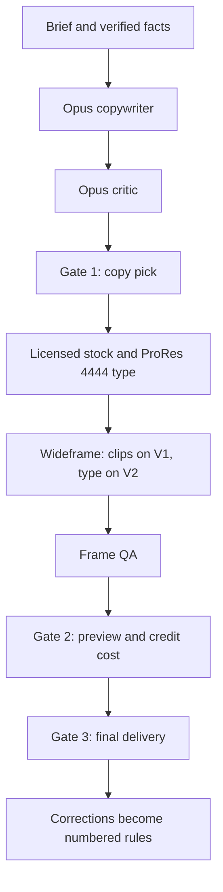

# GTM-skills

GTM skills for core workflows. One folder per skill. Each skill is a `SKILL.md` with YAML frontmatter (`name` and `description`) and a markdown body.

## Skills

- [b2b-video-ad-production-team](b2b-video-ad-production-team/SKILL.md) — Canonical B2B short-video pipeline: orchestrator, Opus writer and critic, Wideframe assembly, and the approval gates.
- [b2b-video-ad-copy-loop](b2b-video-ad-copy-loop/SKILL.md) — Copy rules and the writer/critic loop for a short B2B video ad, before the user sees options.
- [video-ad-pipeline-setup](video-ad-pipeline-setup/SKILL.md) — Machine setup for that pipeline (Opus, customer-data MCP, Wideframe). Pictory and Fable are legacy.
- [linkedin-video-audiences](linkedin-video-audiences/SKILL.md) — Build and verify LinkedIn Campaign Manager video-retargeting audiences separated by positioning theme.
- [cold-email-volume](cold-email-volume/SKILL.md) — Inbox math, list capacity, provider splits, copy rules, inbox health, and reply triage for high-volume B2B cold email.

## Pipeline

A short B2B video ad (default 16:9, or 1:1 for a common LinkedIn placement) runs like this:

## Contributing

1. Fork the repo and create a branch.
2. Edit the `SKILL.md` you are changing, or add a new folder with its own `SKILL.md`. Keep the frontmatter valid: `name` and `description` are required.
3. Open a pull request against `main`.
4. When a correction is learned from real use, add it as the next numbered rule in that skill. Write the general principle, with a neutral example. Leave client names, people, and confidential facts out of the skill.

This project is licensed under the [MIT License](LICENSE). Copyright 2026 Peter Denton (GitHub: petermdenton). Contributions are accepted under that license.
